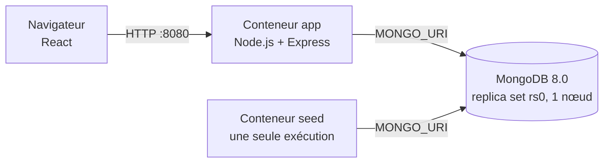

# Regestion : spécification technique de la base de données

> Partie I · Architecture applicative et modèle de données MongoDB
> Version 1.0 (conforme à l'implémentation de la partie I) · 26/11/2026

## 1. Architecture applicative



| Couche | Choix | Raison |
|---|---|---|
| Interface | React 19 + Vite, glisser-déposer avec `@dnd-kit` | Kanban interactif ; compilée en fichiers statiques servis par l'API |
| API | Node.js 22, Express 5, API REST JSON | Un seul conteneur pour l'API et l'interface |
| Accès aux données | Driver officiel `mongodb` 7.x, sans ODM | Maîtrise directe des requêtes, des index et des options de connexion |
| Validation | `zod` côté API, `$jsonSchema` côté MongoDB | Double contrôle : entrée HTTP et document stocké |
| Authentification | JWT dans un cookie `httpOnly`, mots de passe hachés avec `bcryptjs` | Sans état côté serveur ; aucun module natif à compiler |
| Base | MongoDB 8.0 en **replica set à un nœud** | Les transactions exigent un replica set ; la partie II n'aura qu'à changer l'URI |

Le `Dockerfile` est multi-étapes : une étape compile l'interface React, l'étape finale contient Node.js, l'API et les fichiers statiques.

## 2. Configuration

Toute la configuration passe par des variables d'environnement, lues dans le fichier `.env` à la racine. **Aucune adresse de base n'est écrite dans le code.**

| Variable | Exemple (partie I) | Rôle |
|---|---|---|
| `MONGO_URI` | `mongodb://mongo:27017/?replicaSet=rs0` | Chaîne de connexion complète |
| `MONGO_DB` | `taskflow` | Nom de la base |
| `MONGO_WRITE_CONCERN` | `majority` | Niveau d'acquittement des écritures |
| `PORT` | `8080` | Port HTTP de l'application dans le conteneur |
| `APP_PORT` | `8080` | Port publié sur la machine hôte ; à changer s'il est déjà pris |
| `JWT_SECRET` | *(valeur aléatoire)* | Signature des sessions |
| `SEED_ENABLED` | `true` | Insérer les données de test si la base est vide |
| `SEED_DEMO_PASSWORD` | *(valeur de test)* | Mot de passe des comptes de démonstration |

En partie II, seule la valeur de `MONGO_URI` change : elle pointera vers le routeur `mongos`.

## 3. Choix de modélisation

MongoDB permet d'**imbriquer** des données dans un document ou de les **référencer** dans une autre collection. Règle appliquée : on imbrique ce qui est petit, borné et toujours lu avec le parent ; on référence ce qui peut grossir sans limite ou qui est lu seul.

| Donnée | Choix | Justification |
|---|---|---|
| Membres d'un projet | Imbriqués dans `projects` | Liste courte, lue avec le projet (droits, liste des assignables) |
| Colonnes du Kanban | Imbriquées dans `projects` | Moins de 10 éléments, toujours lus avec le projet |
| Étiquettes et checklist | Imbriquées dans `tasks` | Petites, propres à la tâche |
| Tâches | Collection `tasks` | Nombre illimité par projet ; filtrées et triées seules |
| Commentaires | Collection `comments` | Croissance illimitée ; un tableau imbriqué ferait grossir la tâche sans fin |
| Activité | Collection `activities` | Journal en ajout seul, expiré automatiquement |
| Identifiants de connexion | Collection `accounts` | Garantit l'unicité des e-mails, y compris après le sharding (§ 5.2) |

**Toute collection métier porte un champ `companyId`.** C'est la base de l'isolation (§ 6) et la future clé de sharding.

## 4. Collections

Les exemples sont en **JSON étendu MongoDB** (`$oid` pour un ObjectId, `$date` pour une date) afin de rester du JSON valide.

### 4.1 `companies`

```json
{
  "_id": { "$oid": "6745c0a1e4b0a1b2c3d4e001" },
  "name": "Acme",
  "slug": "acme",
  "color": "#2563eb",
  "timezone": "Europe/Paris",
  "ownerId": { "$oid": "6745c0a1e4b0a1b2c3d4e101" },
  "rev": 4,
  "createdAt": { "$date": "2026-11-26T09:00:00Z" },
  "updatedAt": { "$date": "2026-11-26T09:00:00Z" }
}
```

C'est la seule collection métier sans `companyId` : son `_id` joue ce rôle.

### 4.2 `accounts`

Contient les identifiants de connexion. L'`_id` est l'**e-mail normalisé** (minuscules, sans espaces).

```json
{
  "_id": "alice@acme.test",
  "userId": { "$oid": "6745c0a1e4b0a1b2c3d4e101" },
  "companyId": { "$oid": "6745c0a1e4b0a1b2c3d4e001" },
  "passwordHash": "$2a$12$Vq1...",
  "lastLoginAt": { "$date": "2026-11-26T10:12:00Z" },
  "createdAt": { "$date": "2026-11-26T09:00:00Z" }
}
```

La connexion lit un seul document par son `_id`. Le hachage du mot de passe n'est jamais renvoyé par l'API.

### 4.3 `users`

```json
{
  "_id": { "$oid": "6745c0a1e4b0a1b2c3d4e101" },
  "companyId": { "$oid": "6745c0a1e4b0a1b2c3d4e001" },
  "email": "alice@acme.test",
  "name": "Alice Martin",
  "role": "owner",
  "avatarColor": "#f59e0b",
  "createdAt": { "$date": "2026-11-26T09:00:00Z" },
  "updatedAt": { "$date": "2026-11-26T09:00:00Z" }
}
```

`role` ∈ `owner`, `admin`, `member`. Changer l'e-mail modifie `accounts` et `users` dans une même transaction (§ 7).

### 4.4 `projects`

```json
{
  "_id": { "$oid": "6745c0a1e4b0a1b2c3d4e201" },
  "companyId": { "$oid": "6745c0a1e4b0a1b2c3d4e001" },
  "name": "Site web",
  "key": "WEB",
  "description": "Refonte du site vitrine",
  "color": "#10b981",
  "archived": false,
  "members": [
    { "userId": { "$oid": "6745c0a1e4b0a1b2c3d4e102" }, "addedAt": { "$date": "2026-11-26T09:05:00Z" } },
    { "userId": { "$oid": "6745c0a1e4b0a1b2c3d4e103" }, "addedAt": { "$date": "2026-11-26T09:05:00Z" } }
  ],
  "columns": [
    { "key": "todo",        "name": "À faire",  "order": 0, "isDone": false },
    { "key": "in_progress", "name": "En cours", "order": 1, "isDone": false },
    { "key": "review",      "name": "En revue", "order": 2, "isDone": false },
    { "key": "done",        "name": "Terminé",  "order": 3, "isDone": true }
  ],
  "taskCounter": 12,
  "rev": 37,
  "createdBy": { "$oid": "6745c0a1e4b0a1b2c3d4e102" },
  "createdAt": { "$date": "2026-11-26T09:05:00Z" },
  "updatedAt": { "$date": "2026-11-26T11:30:00Z" }
}
```

- `taskCounter` fournit le prochain numéro de tâche, incrémenté de façon atomique : `findOneAndUpdate({ companyId, _id }, { $inc: { taskCounter: 1 } })`.
- `rev` est le compteur de verrouillage des transactions (§ 7.1). Il existe aussi dans `companies`. Il n'est jamais renvoyé par l'API.
- La clé du projet (`key`) n'est pas modifiable : elle fait partie des identifiants de tâches.
- `isDone` désigne la colonne qui compte comme « terminé » dans le tableau de bord.

### 4.5 `tasks`

```json
{
  "_id": { "$oid": "6745c0a1e4b0a1b2c3d4e301" },
  "companyId": { "$oid": "6745c0a1e4b0a1b2c3d4e001" },
  "projectId": { "$oid": "6745c0a1e4b0a1b2c3d4e201" },
  "number": 12,
  "title": "Maquette de la page d'accueil",
  "description": "Proposer deux variantes, mobile et bureau.",
  "status": "in_progress",
  "position": 1536.5,
  "priority": "high",
  "assigneeId": { "$oid": "6745c0a1e4b0a1b2c3d4e103" },
  "dueDate": { "$date": "2026-12-05T00:00:00Z" },
  "labels": ["design", "front"],
  "checklist": [
    { "id": "c1", "text": "Version bureau", "done": true },
    { "id": "c2", "text": "Version mobile", "done": false }
  ],
  "createdBy": { "$oid": "6745c0a1e4b0a1b2c3d4e102" },
  "createdAt": { "$date": "2026-11-26T09:10:00Z" },
  "updatedAt": { "$date": "2026-11-26T11:30:00Z" },
  "completedAt": null
}
```

- `status` contient la `key` d'une colonne du projet.
- `position` ordonne les cartes d'une colonne. Déposer une carte entre deux autres lui donne la moyenne de leurs positions : une seule écriture par déplacement. Si l'écart devient trop petit, la colonne est renumérotée.
- `assigneeId` vaut `null` pour une tâche non assignée.
- `completedAt` est renseigné quand la tâche entre dans la colonne `isDone`.

### 4.6 `comments`

```json
{
  "_id": { "$oid": "6745c0a1e4b0a1b2c3d4e401" },
  "companyId": { "$oid": "6745c0a1e4b0a1b2c3d4e001" },
  "projectId": { "$oid": "6745c0a1e4b0a1b2c3d4e201" },
  "taskId": { "$oid": "6745c0a1e4b0a1b2c3d4e301" },
  "authorId": { "$oid": "6745c0a1e4b0a1b2c3d4e103" },
  "body": "Première variante en ligne, avis bienvenus.",
  "createdAt": { "$date": "2026-11-26T11:31:00Z" },
  "editedAt": null
}
```

`projectId` est recopié pour supprimer en une requête tous les commentaires d'un projet.

### 4.7 `activities`

```json
{
  "_id": { "$oid": "6745c0a1e4b0a1b2c3d4e501" },
  "companyId": { "$oid": "6745c0a1e4b0a1b2c3d4e001" },
  "projectId": { "$oid": "6745c0a1e4b0a1b2c3d4e201" },
  "taskId": { "$oid": "6745c0a1e4b0a1b2c3d4e301" },
  "actorId": { "$oid": "6745c0a1e4b0a1b2c3d4e103" },
  "type": "task.status_changed",
  "data": { "from": "todo", "to": "in_progress" },
  "createdAt": { "$date": "2026-11-26T11:30:00Z" }
}
```

`type` ∈ `task.created`, `task.updated`, `task.status_changed`, `task.assigned`, `task.deleted`, `comment.created`, `project.member_added`, `project.member_removed`. Un index TTL supprime les entrées après 180 jours.

### 4.8 `meta`

Un seul document, `{ "_id": "seed", "version": 1, "insertedAt": { "$date": "..." } }`. Le seed le consulte avant d'insérer : relancer `docker compose up` ne crée pas de doublons.

## 5. Index et contraintes

### 5.1 Index secondaires

| Collection | Index | Requête servie |
|---|---|---|
| `accounts` | `{ companyId: 1, userId: 1 }` | Retrouver le compte d'un utilisateur |
| `users` | `{ companyId: 1, name: 1 }` | Liste et recherche des utilisateurs |
| `projects` | `{ companyId: 1, archived: 1, name: 1 }` | Liste des projets |
| `projects` | `{ companyId: 1, "members.userId": 1 }` | Projets dont je suis membre |
| `tasks` | `{ companyId: 1, projectId: 1, status: 1, position: 1 }` | **Chargement du Kanban** |
| `tasks` | `{ companyId: 1, assigneeId: 1, completedAt: 1, dueDate: 1 }` | Mes tâches, tâches en retard |
| `comments` | `{ companyId: 1, taskId: 1, createdAt: 1 }` | Fil de commentaires |
| `activities` | `{ companyId: 1, projectId: 1, createdAt: -1 }` | Historique du projet |
| `activities` | `{ createdAt: 1 }`, TTL 180 jours | Expiration automatique |

Chaque index commence par `companyId`. Une requête d'une entreprise ne parcourt donc que ses propres entrées d'index.

### 5.2 Aucun index unique hors `_id`

En partie II, les collections seront shardées avec une clé hachée. MongoDB n'accepte alors un index unique que s'il commence par la clé de sharding, et une clé hachée ne peut pas porter de contrainte d'unicité. Un index unique créé dès la partie I ferait échouer le sharding. Les contraintes d'unicité sont donc traitées autrement :

| Contrainte | Mécanisme |
|---|---|
| E-mail unique (RG-01) | L'e-mail est l'`_id` de `accounts`. Une seconde insertion échoue avec une erreur de doublon, avant et après le sharding. |
| Clé de projet unique dans l'entreprise (RG-09) | Vérification dans une transaction qui verrouille d'abord l'entreprise (§ 7.1) |
| Numéro de tâche unique dans le projet | Compteur atomique `taskCounter` |

### 5.3 Validation `$jsonSchema`

Chaque collection reçoit un validateur MongoDB : champs obligatoires, types, énumérations (`role`, `priority`) et présence de `companyId`. Extrait pour `tasks` :

```json
{
  "$jsonSchema": {
    "bsonType": "object",
    "required": ["companyId", "projectId", "number", "title", "status", "position", "priority", "createdAt"],
    "properties": {
      "companyId":  { "bsonType": "objectId" },
      "projectId":  { "bsonType": "objectId" },
      "number":     { "bsonType": "int", "minimum": 1 },
      "title":      { "bsonType": "string", "minLength": 1, "maxLength": 200 },
      "status":     { "bsonType": "string" },
      "position":   { "bsonType": ["double", "int"] },
      "priority":   { "enum": ["low", "medium", "high", "urgent"] },
      "assigneeId": { "bsonType": ["objectId", "null"] },
      "labels":     { "bsonType": "array", "maxItems": 20, "items": { "bsonType": "string" } }
    }
  }
}
```

## 6. Isolation entre entreprises

L'isolation est assurée à trois niveaux.

1. **Session.** Le jeton de session contient `userId` et `companyId`. À chaque requête, un middleware recharge l'utilisateur avec `{ _id: userId, companyId }`. S'il n'existe plus, la session est refusée.
2. **Accès aux données.** Les routes n'utilisent jamais une collection directement. Elles passent par un dépôt lié à l'entreprise de la session : `scoped(db, companyId).tasks`. La seule exception est la connexion, qui lit `accounts` par e-mail pour découvrir l'entreprise (et l'inscription, qui la crée). Ce dépôt :
   - ajoute `companyId` à **tous** les filtres (`find`, `update`, `delete`, `aggregate` via un `$match` en tête) ;
   - impose `companyId` à chaque insertion et ignore toute valeur envoyée par le client ;
   - refuse toute mise à jour qui modifierait `companyId`, les remplacements de document et les `upsert` ;
   - refuse les étapes d'agrégation qui liraient une autre collection (`$lookup`, `$unionWith`…).
3. **Références.** Avant de lier deux objets, l'API vérifie que la cible existe **dans la même entreprise**. Par exemple, un `assigneeId` doit apparaître dans `project.members`. Sinon, elle répond 404.

Les entrées sont validées par des schémas stricts sur les types, ce qui empêche l'injection d'opérateurs (`{ "$ne": null }`). La session est un cookie `httpOnly` et `SameSite=Strict` de 8 heures ; les échecs de connexion sont limités en fréquence.

Des tests automatisés (`tests/api.test.mjs`) créent deux entreprises et vérifient que les routes visant les objets de l'une renvoient 404 à l'autre.

## 7. Intégrité et suppressions

MongoDB n'a pas de clés étrangères : les cascades sont faites par l'application. Les opérations qui touchent plusieurs documents utilisent une **transaction** (`session.withTransaction`, qui relance automatiquement en cas d'erreur transitoire).

| Opération | Effets dans la transaction |
|---|---|
| Inscription | Insère `accounts` (échoue si l'e-mail existe), `companies` et `users` |
| Supprimer une entreprise | `deleteMany({ companyId })` sur toutes les collections, dont `accounts`, puis supprime la `company` |
| Supprimer un projet | Supprime le projet et ses `tasks`, `comments` et `activities` |
| Supprimer un utilisateur | Supprime `users` et `accounts` ; le retire des `members` ; met `assigneeId` à `null` sur ses tâches |
| Retirer un membre d'un projet | `$pull` sur `members` ; désassigne ses tâches du projet |
| Transférer la propriété | Met à jour `companies.ownerId` ; l'ancien propriétaire devient `admin`, le nouveau `owner` |
| Supprimer une colonne non vide | Déplace ses tâches vers la colonne choisie, puis retire la colonne |

### 7.1 Accès simultanés

Une transaction MongoDB lit un état cohérent (*snapshot*), mais n'empêche pas deux transactions de lire la même situation puis d'écrire **des documents différents**. Exemples :

- deux créations simultanées voient la clé `WEB` libre, et créent deux projets `WEB` ;
- une transaction assigne une tâche à Chloé pendant qu'une autre la retire du projet : la tâche reste assignée à une non-membre.

**Solution :** chaque transaction écrit d'abord dans le document parent commun (`$inc: { rev: 1 }`). Deux transactions concurrentes entrent alors en conflit d'écriture ; MongoDB en annule une, que le driver relance. La seconde voit le résultat de la première.

| Verrou | Opérations sérialisées |
|---|---|
| Entreprise (`companies.rev`) | Création de projet, création, modification et suppression d'utilisateur, ajout d'un membre, transfert, suppression de l'entreprise |
| Projet (`projects.rev`) | Modification, archivage et suppression du projet, membres, colonnes, tâches, déplacements, commentaires |

La suppression d'un utilisateur incrémente aussi le `rev` des projets dont il était membre.

Les tests de concurrence ont été validés dans les deux sens : ils réussissent avec les verrous, et trois d'entre eux (clé en double, assigné non membre, membre fantôme) échouent quand on les retire.

## 8. Requêtes principales

```js
// Kanban d'un projet : un seul parcours de l'index { companyId, projectId, status, position }
db.tasks.find({ companyId, projectId }).sort({ status: 1, position: 1 })

// Mes tâches ouvertes, les plus urgentes d'abord
db.tasks.find({ companyId, assigneeId: me, completedAt: null }).sort({ dueDate: 1 })

// Tableau de bord : nombre de tâches par statut et par projet
db.tasks.aggregate([
  { $match: { companyId } },
  { $group: { _id: { projectId: "$projectId", status: "$status" }, count: { $sum: 1 } } }
])

// Déplacement d'une carte : une écriture filtrée sur la clé complète
db.tasks.updateOne(
  { companyId, _id: taskId },
  { $set: { status: "review", position: 2048, updatedAt: new Date() } }
)
```

Les noms des assignés sont résolus par l'application : elle charge une fois les membres du projet, puis les associe aux tâches.

## 9. Préparation de la partie II

| Décision prise dès la partie I | Bénéfice en partie II |
|---|---|
| Connexion entièrement définie par `MONGO_URI` | Passage au cluster sans modifier le code |
| `companyId` dans chaque document métier, en tête de chaque filtre | Clé de sharding prête ; requêtes ciblées sur un shard |
| Mises à jour unitaires des collections métier filtrées sur `{ companyId, _id }` | Écritures envoyées directement au bon shard. Exception : les écritures sur `accounts` par `{ companyId, userId }` ne contiennent pas sa clé de sharding (`_id`) ; elles sont rares et à vérifier en partie II |
| Aucun index unique hors `_id` | Sharding possible sans restructurer la base |
| Replica set dès le départ, écritures `majority` | Mêmes transactions et même comportement que sur le cluster |
| Seed idempotent dans un conteneur à part | Réutilisé tel quel par l'infrastructure distribuée |

## 10. Déploiement Docker (partie I)

| Service | Image | Rôle |
|---|---|---|
| `mongo` | `mongo:8.0` (image officielle, version fixée) | Lancé avec `--replSet rs0`. Son contrôle de santé initialise le replica set s'il ne l'est pas encore. Données dans le volume `taskflow_mongo_data`. Aucun port publié sur l'hôte. |
| `seed` | image de l'application | Crée les collections, les validateurs et les index, insère les données de test, puis s'arrête |
| `app` | image de l'application | API et interface sur le port 8080. Démarre après la fin réussie de `seed`. |

Le fichier `compose.yml` fixe le nom du projet (`name: taskflow`). Sans cela, Docker Compose le déduit du nom du dossier et pourrait réutiliser les volumes d'un autre projet placé dans un dossier de même nom. La pile ne dépend d'aucun conteneur MongoDB déjà présent sur la machine.

Ordre de démarrage, piloté par `depends_on` : `mongo` (sain) → `seed` (terminé avec succès) → `app`.

Le service est disponible sur `http://localhost:8080` après `docker compose up -d --build`. `docker compose down -v` remet la base à zéro.
