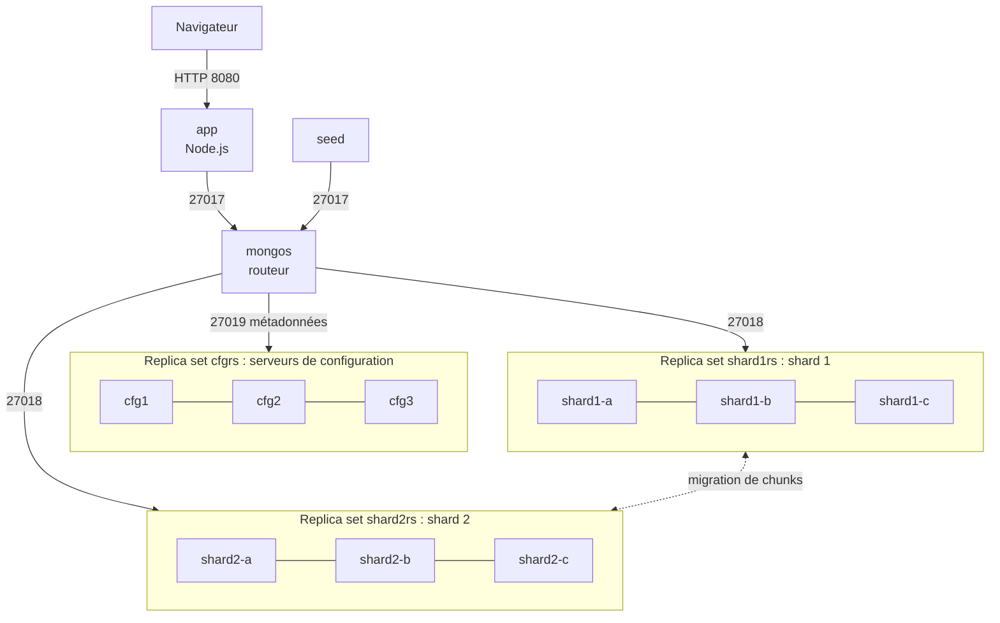
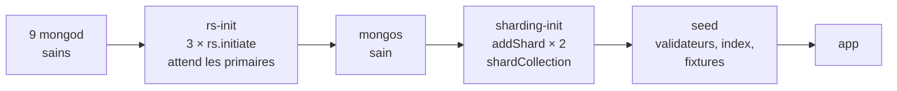

# Regestion : spécification technique de l'infrastructure distribuée

> Partie II · Réplication, sharding, routage et flux réseau
> Version 0.1 (conception) · 26/11/2026

## 1. Objectifs

| Besoin | Réponse |
|---|---|
| **Haute disponibilité** : continuer à servir si un serveur tombe | Chaque shard et les serveurs de configuration forment un **replica set de 3 membres**, avec élection automatique d'un nouveau primaire |
| **Montée en charge** : répartir données et requêtes | Les données sont réparties sur **2 shards** selon une clé fondée sur l'entreprise ; on peut ajouter des shards plus tard |
| **Application inchangée** | Seule la variable `MONGO_URI` change ; le code de l'application est identique à la partie I |

## 2. Topologie



### Conteneurs

| Service | Rôle | Commande principale | Port interne |
|---|---|---|---|
| `cfg1`, `cfg2`, `cfg3` | Serveurs de configuration : stockent la carte des chunks, la liste des shards et l'état du balancer | `mongod --configsvr --replSet cfgrs` | 27019 |
| `shard1-a`, `-b`, `-c` | Shard 1, données métier | `mongod --shardsvr --replSet shard1rs` | 27018 |
| `shard2-a`, `-b`, `-c` | Shard 2, données métier | `mongod --shardsvr --replSet shard2rs` | 27018 |
| `mongos` | Point d'entrée unique : envoie chaque requête au bon shard | `mongos --configdb cfgrs/cfg1:27019,cfg2:27019,cfg3:27019` | 27017 |
| `rs-init` | Initialise les trois replica sets, puis s'arrête | script `mongosh` | — |
| `sharding-init` | Ajoute les shards et sharde les collections, puis s'arrête | script `mongosh` | — |
| `seed` | Crée validateurs et index, insère les données de test, puis s'arrête | image de l'application | — |
| `app` | API et interface (identique à la partie I) | `node server.js` | 8080 |

Tous les services MongoDB utilisent l'image officielle `mongo:8.0`. Le projet Compose est nommé `taskflow` et ses volumes sont préfixés `taskflow_`, pour ne pas réutiliser les données d'un autre projet.

Tous les `mongod` sont lancés avec `--bind_ip_all` et `--wiredTigerCacheSizeGB 0.25`, et chacun a son volume nommé. Les 9 `mongod` et le `mongos` demandent environ **4 Go de RAM** dans Docker Desktop. Tous les services de longue durée ont `restart: unless-stopped`.

### Réseaux Docker

| Réseau | Type | Membres |
|---|---|---|
| `front` | bridge | `app`, seul service qui publie un port sur l'hôte (8080) |
| `data` | bridge `internal: true`, sans accès extérieur | tous les nœuds MongoDB, `mongos`, les conteneurs d'initialisation, `seed` et `app` |

Pour les démonstrations avec Compass, on peut aussi publier `mongos` sur `localhost:27017`.

## 3. Flux réseau

| # | Source | Destination | Port | Contenu |
|---|---|---|---|---|
| 1 | Navigateur | `app` | 8080 (HTTP) | Interface et API REST |
| 2 | `app`, `seed` | `mongos` | 27017 | Protocole MongoDB : toutes les lectures et écritures de l'application |
| 3 | `mongos` | `cfg1..3` | 27019 | Lecture de la carte des chunks, mise en cache et rafraîchie quand elle change |
| 4 | `mongos` | membres des shards | 27018 | Requêtes routées vers le **primaire** du shard concerné ; surveillance des membres pour suivre les élections |
| 5 | Membres d'un même replica set | entre eux | 27018 / 27019 | **Heartbeats** toutes les 2 s ; **réplication** : les secondaires lisent l'oplog du primaire et le rejouent ; votes lors d'une élection |
| 6 | Primaires des shards | `cfgrs` | 27019 | Mise à jour des métadonnées après un découpage ou une migration de chunk |
| 7 | `shard1rs` ↔ `shard2rs` | entre eux | 27018 | **Migration de chunks**, décidée par le balancer qui tourne sur le primaire de `cfgrs` |
| 8 | `rs-init` | tous les `mongod` | 27018 / 27019 | `rs.initiate()` au premier démarrage |
| 9 | `sharding-init` | `mongos` | 27017 | `sh.addShard()`, `sh.shardCollection()` |

L'application ne parle **qu'au `mongos`** (flux 2). Elle ignore combien de shards existent et où sont les primaires.

## 4. Réplication

### Configuration des replica sets

```js
rs.initiate({
  _id: "shard1rs",
  members: [
    { _id: 0, host: "shard1-a:27018" },
    { _id: 1, host: "shard1-b:27018" },
    { _id: 2, host: "shard1-c:27018" }
  ]
})
```

`shard2rs` et `cfgrs` suivent le même modèle ; `cfgrs` ajoute `configsvr: true`.

| Paramètre | Valeur | Justification |
|---|---|---|
| Membres par replica set | 3, tous porteurs de données, 1 vote chacun | La majorité vaut 2 : le replica set survit à la perte d'un membre |
| Priorités | Toutes à 1 | Pas de seconde élection quand l'ancien primaire revient : il redevient secondaire |
| `electionTimeoutMillis` | 10 000 (défaut) | Un primaire injoignable 10 s déclenche une élection |
| Write concern | `w: "majority"` | Une écriture acquittée existe sur 2 membres ; elle ne peut pas être perdue lors d'un changement de primaire |
| Read preference | `primary` | Lectures toujours à jour, cohérentes avec les écritures |

### Reprise après la perte d'un primaire

1. Le primaire de `shard1rs` s'arrête.
2. Les secondaires ne reçoivent plus ses heartbeats. Après 10 s, l'un d'eux se porte candidat et obtient 2 votes sur 3.
3. `mongos` voit le nouveau primaire et lui envoie les requêtes suivantes.
4. Pendant l'élection, les écritures sur ce shard échouent. Le driver relance une fois une écriture interrompue (`retryWrites=true`). Si l'élection dure plus longtemps, l'API répond **503**. L'interface réessaie automatiquement les lectures ; une écriture en échec est signalée à l'utilisateur et n'est pas rejouée, pour ne jamais l'exécuter deux fois.
5. Les entreprises stockées sur `shard2rs` ne voient aucune interruption.
6. Au redémarrage, l'ancien primaire revient en **secondaire** et rattrape son retard avec l'oplog.

Aucune action manuelle et aucun redémarrage de l'application ne sont nécessaires.

## 5. Sharding

### 5.1 Clé retenue

| Collection | Clé de sharding |
|---|---|
| `users`, `projects`, `tasks`, `comments`, `activities` | `{ companyId: "hashed", _id: 1 }` |
| `companies` | `{ _id: "hashed" }` |
| `accounts` | `{ _id: "hashed" }` (l'`_id` est l'e-mail) |
| `meta` | non shardée : reste sur le shard primaire de la base |

### 5.2 Justification

Une bonne clé de sharding a une **cardinalité** élevée, **répartit** les écritures sans point chaud, et permet des **requêtes ciblées** sur un seul shard.

| Critère | `{ companyId: "hashed", _id: 1 }` |
|---|---|
| Requêtes ciblées | Toutes les requêtes de l'application filtrent sur `companyId` (spécification BDD, § 6). `mongos` les envoie au seul shard qui contient l'entreprise, sans interroger les autres. |
| Répartition | Le hachage de `companyId` disperse les entreprises sur toute la plage de valeurs. Les nouvelles entreprises se répartissent entre les shards au lieu de s'accumuler sur le dernier. |
| Grosses entreprises | Le second champ, `_id`, permet de découper les données d'une même entreprise en plusieurs chunks, et donc de les répartir si elle devient très volumineuse. |
| Isolation | Les données d'une entreprise sont regroupées : la plupart de ses requêtes ne touchent qu'un shard. |
| Écritures unitaires | Les mises à jour filtrent sur `{ companyId, _id }`, c'est-à-dire la clé complète : elles vont directement au bon shard. |

### 5.3 Clés écartées

| Clé | Pourquoi elle est écartée |
|---|---|
| `{ companyId: 1 }` (plage) | Les `companyId` sont des ObjectId croissants : toutes les nouvelles entreprises arrivent sur le même shard. Une grosse entreprise forme un chunk impossible à découper. |
| `{ companyId: "hashed" }` | Bonne répartition, mais une entreprise reste dans un chunk indivisible. |
| `{ _id: "hashed" }` | Répartition parfaite, mais les données d'une entreprise sont dispersées : chaque Kanban interroge **tous** les shards. |
| `{ projectId: ... }` | Les listes à l'échelle de l'entreprise (tableau de bord, mes tâches) interrogeraient tous les shards. |
| `{ status: 1 }` | Quelques valeurs seulement : impossible de répartir. |

### 5.4 Création des chunks

`sh.shardCollection()` est appelé **sur des collections vides**, avant le seed. Avec un préfixe haché, MongoDB pré-découpe la plage de hachage et répartit les chunks entre les deux shards dès la création. Les données de test se répartissent donc dès leur insertion, sans attendre le balancer. Le seed génère une trentaine d'entreprises de tailles variées pour rendre cette répartition visible.

### 5.5 Évolution possible

Les **zones** de sharding pourraient placer les entreprises « premium » sur un shard dédié. La clé actuelle le permet.

## 6. Démarrage automatisé



L'ordre est imposé par `depends_on` : `service_healthy` pour les `mongod` et le `mongos` (contrôle de santé `db.adminCommand('ping')`), `service_completed_successfully` pour les trois conteneurs à exécution unique.

Chaque étape est **idempotente** : un second `docker compose up` ne refait rien et ne crée pas d'erreur.

| Étape | Test avant action |
|---|---|
| `rs.initiate` | Seulement si `rs.status()` renvoie l'erreur *NotYetInitialized* (code 94) |
| `sh.addShard` | Seulement si le shard est absent de `listShards` |
| `sh.shardCollection` | Seulement si la collection est absente de `config.collections` |
| Seed | Seulement si le document `meta` `{ _id: "seed" }` est absent |

Les scripts shell sont enregistrés avec des fins de ligne **LF** (imposées par `.gitattributes`) pour fonctionner dans les conteneurs Linux depuis Windows.

## 7. Configuration de l'application

Seul le fichier `.env` diffère de la partie I :

```dotenv
# Partie I
MONGO_URI=mongodb://mongo:27017/?replicaSet=rs0
# Partie II
MONGO_URI=mongodb://mongos:27017/?retryWrites=true&retryReads=true&w=majority
```

Avec `mongos`, l'URI ne contient pas de paramètre `replicaSet` : c'est le routeur qui suit les replica sets.

## 8. Plan de tests et de démonstration

Les commandes s'exécutent depuis l'hôte avec `docker compose exec <service> mongosh ...`, et des scripts dans `scripts/` les regroupent. Les résultats nourrissent l'analyse demandée.

| # | Test | Méthode | Résultat attendu |
|---|---|---|---|
| T1 | Application sur le cluster | Connexion, création d'un projet et d'une tâche, glisser-déposer | Mêmes fonctionnalités qu'en partie I |
| T2 | Copies multiples | `rs.status()` sur chaque shard ; même comptage `db.tasks.countDocuments()` lu sur chacun des 3 membres d'un shard ; `rs.printSecondaryReplicationInfo()` | 1 primaire et 2 secondaires ; comptages identiques ; retard proche de 0 s |
| T3 | Répartition | `sh.status()` ; `db.tasks.getShardDistribution()` ; comptage direct sur chaque shard | Chunks et documents présents sur les deux shards |
| T4 | Requêtes ciblées | `explain()` d'une requête avec `companyId`, puis d'une requête sans | `SINGLE_SHARD` dans le premier cas, `SHARD_MERGE` dans le second : justifie la clé |
| T5 | Perte d'un primaire | Repérer le shard de l'entreprise de démo, arrêter son primaire (`docker compose stop`), envoyer une requête par seconde à l'API | Erreurs pendant environ 10 à 15 s, puis reprise seule ; les autres entreprises ne sont pas touchées |
| T6 | Retour de l'ancien primaire | `docker compose start` du nœud arrêté | Il revient en secondaire et rattrape son retard |
| T7 *(option)* | Perte de 2 membres sur 3 | Arrêter deux nœuds d'un shard | Plus de primaire : ce shard n'accepte plus d'écritures, l'autre continue. Illustre la règle de la majorité. |

## 9. Limites et évolutions

| Limite | Évolution |
|---|---|
| Un seul `mongos` : s'il tombe, l'application perd l'accès à la base | Lancer deux routeurs et les lister dans l'URI (`mongodb://mongos1:27017,mongos2:27017/...`) ; le driver bascule seul |
| Tous les conteneurs tournent sur une seule machine : une panne de l'hôte arrête tout | En production, répartir les membres de chaque replica set sur des machines ou des zones différentes |
| Pas d'authentification entre les nœuds ni de TLS (environnement de cours) | Fichier `keyFile` partagé, utilisateurs MongoDB et TLS |
| Environ 4 Go de RAM nécessaires | Réduire le cache WiredTiger ou le nombre de membres en démonstration |
